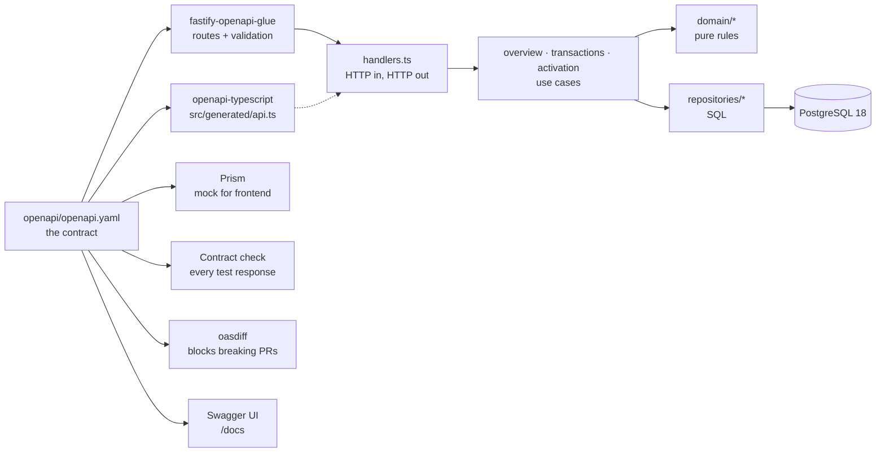
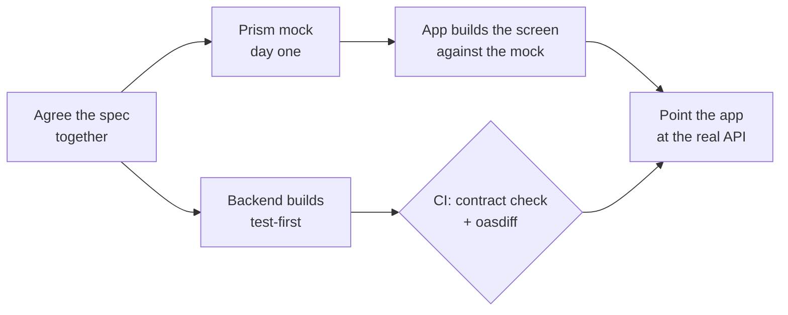
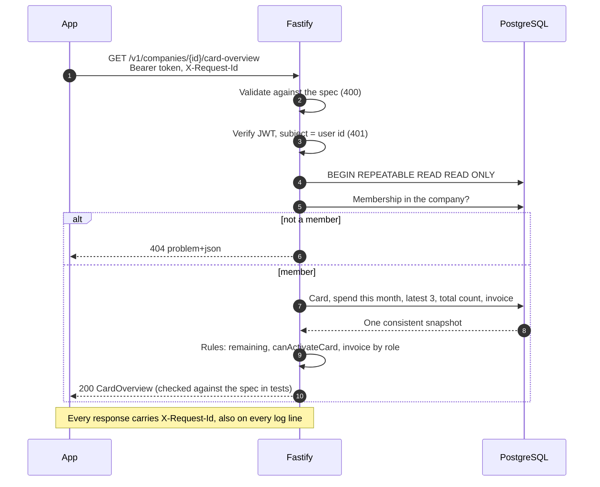

# Card Overview API

Backend for the card overview screen in the mobile app: the company switcher, the card, "Invoice due", remaining spend against the user's own limit, the latest transactions and the "Activate card" button.

Built **contract-first**: the OpenAPI spec was written and mocked before any backend code, so frontend can build in parallel from day one. The spec then drives the code, so the two cannot drift.

- **Contract:** [`openapi/openapi.yaml`](openapi/openapi.yaml)
- **Domain language:** [`CONTEXT.md`](CONTEXT.md)
- **Decisions:** [`docs/adr/`](docs/adr)

## The case

Qred's Node.js Backend Developer case has two tasks:

| Task | Where |
|---|---|
| **1. Collaboration:** how frontend and backend can work in parallel, and how that fits Qred's values (transparency, innovation, passion) | [Presentation](https://claude.ai/artifact/1LjjfMdj42R8UaZDQtNfHx) ([in Swedish](https://claude.ai/artifact/RSRgubiXyJu95ZDEydds9p)) |
| **2. API:** the backend for the card overview screen, in Node.js and TypeScript | This repository |

The two tasks are connected. The presentation proposes agreeing the API contract first and building both sides in parallel. This repository was built that way: the spec and the mock came first, the code after, and CI keeps them in line.

**Where to start:** [Quick start](#quick-start) runs everything with one command, [From the screen to the API](#from-the-screen-to-the-api) shows how the design maps to the payload, and [With more time](#with-more-time) lists what I would do next.

## Quick start

Requires only Docker.

```bash
docker compose up
```

| Service | What it does |
|---|---|
| `db` | PostgreSQL 18 on `:5432` |
| `setup` | Runs the migrations and loads the demo data as the schema owner, then exits. Every `up` resets the demo data. |
| `api` | The API on http://localhost:3000, docs on http://localhost:3000/docs. Connects as `card_api`, with only the privileges it needs. |
| `mock` | The contract as a Prism mock on http://localhost:4010 |

### Try it in Swagger

Open http://localhost:3000/docs. Demo mode is on in `docker compose` ([ADR 0009](docs/adr/0009-demo-tokens-outside-the-contract.md)), so everything happens in the browser:

1. **You are already signed in as Anna** when the page opens: the locks are closed, and the sign-in survives a reload.
2. **Call the API.** Every operation is ready, with the demo ids filled in: open it and click **Execute**.
3. **Switch user.** Run **Demo → `POST /demo/token`** with `erik`: the page signs in as Erik for every call. Each operation's description says who may call it. To use your own token, paste it into **Authorize**.

| Operation | What you see as Anna |
|---|---|
| `GET /v1/me/companies` | Bygg Norr AB and Company AB |
| `GET /v1/companies/{companyId}/card-overview` | The design: active card •••• 4821, 5 400 of 10 000 kr remaining, invoice due, 3 latest transactions of 57 |
| `GET /v1/cards/{cardId}/transactions` | The first 20 transactions; pass `nextCursor` as `cursor` for the next page |

4. **Activate a card.** Sign in as `erik` (step 3), then open `POST /v1/cards/{cardId}/activation`: Erik's card is filled in. Pick a body from **Examples**:

| Example | Result |
|---|---|
| Wrong digits (`0000`) | `422` with `attemptsRemaining: 4`. After 5 wrong tries: `423` locked |
| Erik's card (`7310`) | `200`, the card is `ACTIVE`. Run the overview again as Erik: the digits show and the button is gone |

To start over, reset the demo data: `docker compose run --rm setup`.

The contract file contains no demo data: the token endpoint and the prefilled ids are added only on `/docs`, and only when `DEMO_MODE=true`. Without Docker, use `npm run token -- anna` and paste that token instead.

### Try it with curl

```bash
ANNA=$(docker compose exec -T api node dist/scripts/token.js anna)   # owner of Company AB, active card
ERIK=$(docker compose exec -T api node dist/scripts/token.js erik)   # employee, inactive card (last4 7310)

curl -H "Authorization: Bearer $ANNA" localhost:3000/v1/me/companies
curl -H "Authorization: Bearer $ANNA" localhost:3000/v1/companies/01900000-0000-7000-8000-0000000000c1/card-overview
curl -H "Authorization: Bearer $ANNA" "localhost:3000/v1/cards/01900000-0000-7000-8000-0000000000a1/transactions?limit=5"
curl -X POST -H "Authorization: Bearer $ERIK" -H 'content-type: application/json' \
     -d '{"last4":"7310"}' localhost:3000/v1/cards/01900000-0000-7000-8000-0000000000a2/activation
```

`npm run token:docker -- anna` is the same shortcut. CI starts this stack and runs [`scripts/docker-smoke.sh`](scripts/docker-smoke.sh) against it.

### Developing locally

Requires Node 26. Stop the `api` container first (`docker compose stop api`), since both use port 3000.

```bash
npm ci
npm run setup    # .env, Postgres in Docker, migrations, demo data
npm run dev      # http://localhost:3000, reloads on change
npm run token -- anna
```

`npm run db:seed` resets the demo data at any time.

**Production build:** the `Dockerfile` builds a small image with the compiled code and production dependencies only, running as a non-root user. Without Docker: `npm run build`, then `npm run db:migrate:prod` and `npm run start:prod`. Two instances migrating at once are safe: they take turns on a database lock.

**API docs:** http://localhost:3000/docs (Swagger UI), written for frontend: how to build the screen, what to show for every error, formats, and a named example for every state of the screen. See [Try it in Swagger](#try-it-in-swagger) for the demo flow.

**Logs:** `docker compose logs -f api` and `npm start` print one JSON object per line, as in production; `npm run dev` prints readable, coloured logs. Set the level with `LOG_LEVEL` (`debug`, `info`, `warn`, `error`; default `info`).

**Frontend without the backend:** `docker compose up` already serves the contract with Prism on `http://localhost:4010`; `npm run mock` does the same without Docker. Pick a state with a header: `Prefer: example=inactiveCard` (or `activeCard`, `activationLocked`, `frozenCard`, `noCard`), or an error with `Prefer: code=423`.

## From the screen to the API

| On screen | Field in `GET /v1/companies/{companyId}/card-overview` |
|---|---|
| Company AB ⌄ | `company`, and the list from `GET /v1/me/companies` |
| Invoice due › | `invoiceDue` (owners and admins only, `null` when nothing is due) |
| Card image › | `card.imageUrl`, `card.status`, `card.last4` |
| Remaining spend: 5 400/10 000 kr, based on your set limit | `spend.remaining` / `spend.limit` (and `spend.spent`) |
| Latest transactions | `latestTransactions.items` (3 newest) |
| 54 more items in transaction view › | `latestTransactions.totalCount − items.length`, then `GET /v1/cards/{cardId}/transactions` |
| Activate card | `actions.canActivateCard`, `actions.activationBlockedReason`, then `POST /v1/cards/{cardId}/activation` |
| Contact Qred's support | `support` |

### Payload design

- **One call per screen.** Mobile pays for every round trip, so the screen gets everything at once ([ADR 0002](docs/adr/0002-one-screen-shaped-endpoint.md)).
- **The backend decides.** `remaining`, `canActivateCard` and `activationBlockedReason` are computed on the server, so business rules live in one place and the app has none of its own.
- **Money is `{ minor, currency }`.** Integer öre, never floats; formatting is left to the client's locale ([ADR 0004](docs/adr/0004-money-in-minor-units.md)).
- **`null` means "nothing to show".** A member without a card gets `card: null` and an empty state, not an error.
- **Consistent numbers.** Spend, latest transactions and the total count come from one database snapshot ([ADR 0007](docs/adr/0007-spend-is-computed-on-read.md)).
- **Errors are RFC 9457 `problem+json`**, with extra fields where the app needs them (`attemptsRemaining`).

### Database design

See [`db/migrations/001_init.sql`](db/migrations/001_init.sql).

- **Membership is the access boundary.** `company_members` decides what a user can see; the token only says who they are ([ADR 0006](docs/adr/0006-identity-in-token-access-in-database.md)).
- **The database refuses invalid states**: spend limit above credit limit, an inactive card with an activation date, a zero-amount transaction, a transaction in another currency than its card (composite foreign key, migration 002).
- **Indexes match the queries**: `(card_id, occurred_at DESC, id DESC)` serves both "latest 3" and pagination; a partial index covers only unpaid invoices.
- **PostgreSQL 18** with time-ordered `uuidv7()` ids ([ADR 0003](docs/adr/0003-postgres.md)).

## Architecture

### One spec feeds everything



### Frontend and backend in parallel



### One request: the card overview



### Activating a card


Each step is one SQL statement, so twelve parallel guesses still get exactly five tries.

### Files

```
openapi/openapi.yaml     the contract; everything below is driven by it
db/migrations/           SQL migrations, applied in name order
db/init/                 local only: creates the API's database login on first start
src/
  app.ts                 builds the Fastify app from the spec (used by server and tests)
  server.ts              process entry: config, logging, graceful shutdown
  config.ts              typed, validated config; refuses to start if anything is missing
  auth.ts                JWT verification (HS256, subject = user id)
  api.ts                 shapes from the spec: schemas, path, query and body per operation
  handlers.ts            one thin handler per operationId
  overview.ts            use case: the card overview screen in one snapshot
  transactions.ts        use case: paginated transactions with an opaque cursor
  activation.ts          use case: activate a card, count wrong attempts
  domain/                pure rules (spend period, activation, spend summary) and the domain types
  repositories/          SQL, one file per aggregate
  mappers.ts             database rows to API shapes
  problem.ts             problem+json errors
  db.ts                  transactions and snapshots, safe integer parsing
  generated/api.ts       types generated from the spec (checked in CI)
scripts/                 migrate, seed (both need only DATABASE_URL), token, docker-smoke.sh
test/                    HTTP tests against real Postgres, plus the contract checker
Dockerfile               production image: compiled code, production dependencies, non-root
docker-compose.yml       db, setup (migrate + seed), api and mock
```

## Edge cases handled

- No access to a company or card → **404**, same as "does not exist", so ids of other customers are not confirmed ([ADR 0005](docs/adr/0005-404-when-the-user-has-no-access.md)).
- Member without a card → empty state. Several cards → the newest one that is not closed, so a replacement card issued while the old one still works shows up with its "Activate card" button. Frozen cards are shown.
- Spend uses the **calendar month in Swedish time**: a purchase at 00:30 on the 1st belongs to the new month, across summer/winter time.
- Pending and settled purchases count, refunds reduce spend in the month they arrive, declined ones are ignored. Spent never goes below zero and remaining never goes below zero.
- Invoices are visible to owners and admins only. Overdue the day after the due date, in Swedish time.
- Pagination never repeats or skips rows when new transactions arrive; ties on the same timestamp are ordered by id; cursors from another card are rejected.
- Activation requires the last 4 digits, hidden while the card is inactive. Wrong digits → **422** with attempts left; after 5 → **423** until support unlocks. Already active with the right digits → **200** (safe to retry); wrong digits on an active card, or a frozen or closed card → **409** ([ADR 0008](docs/adr/0008-activation-proof-and-lockout.md)).
- Concurrent activation attempts cannot get extra guesses: the counter is one atomic `UPDATE`. Right and wrong digits at the same time activate once. A holder who has left the company cannot see or activate the card.
- Activation is also **rate limited per user** across all their cards (10 per 15 minutes by default) → **429** with `Retry-After`. It counts after the token check, so nobody can use up another user's attempts. The lockout protects one card; the rate limit protects the service.
- Every response has `Cache-Control: no-store`, so no proxy or device cache keeps personal financial data.
- Invalid input gets `400` with an `errors` list: every invalid field at once, where it is (`body`, `query`, `path`) and what is wrong, so the app can mark the right fields. A method the route does not take gets `405` with an `Allow` header (no `HEAD` routes outside the contract); an unknown route gets `404` naming it. `401` carries `WWW-Authenticate: Bearer`, and `instance` in an error is the path only, never a query with a cursor.
- Unknown body fields are rejected, not silently dropped (unknown query parameters are ignored). Non-JSON bodies get **415** instead of skipping validation. Tokens without an expiry or with a non-uuid subject are rejected.
- Database down or overloaded (connection lost, connect timeout, query timeout) → **503** with `Retry-After`, so the app can offer "Try again". `/live` still answers 200 (liveness, no database), while `/health` answers 503 (readiness), so the platform stops sending traffic instead of restarting healthy instances. A dropped idle connection is logged, not a crash; a failed transaction keeps its original error and the broken connection is discarded. A bug returns a generic 500 and is logged, never leaked, and the app keeps serving. An error outside any request is logged as fatal and the process exits, so the platform starts a clean one.

## Security

| Threat | Protection |
|---|---|
| Reading another customer's data | Access is checked in the database on every request (membership), never trusted from the token or the URL. No access and "does not exist" give the same `404`. `/v1/me/...` has no user id to tamper with. |
| Forged or stolen tokens | HS256 only (no `alg: none`), and `exp`, `iat`, `sub`, `iss` and `aud` are required, so a token for another service is refused even with the same key. A token issued more than an hour ago is refused whatever its expiry says, which limits what a stolen token is worth; demo tokens live one hour. Tokens are redacted from the logs. |
| Guessing activation digits | 5 wrong attempts lock the card (one atomic `UPDATE`, safe under concurrency), plus a per-user rate limit. Every outcome is an audit log event (`event: card_activation`, never the digits), the lockout a warning, and the card keeps `last_failed_activation_at` ([migration 004](db/migrations/004_activation_audit.sql)). |
| Malformed or oversized input | Every request is validated against the contract: unknown fields are rejected, non-JSON bodies get `415`, bodies over 1 KiB get `413`. Bodies with `__proto__` keys are rejected (prototype pollution). |
| SQL injection | Every query is parameterized; user input is never put into SQL text. |
| A bug or breach in the app reaching the data | The app connects as `card_api`, which can read the tables and update four columns of `cards`, nothing else ([migration 003](db/migrations/003_app_role.sql)). Migrations run as the schema owner. The whole test suite runs as this role, so it proves the app needs no more. |
| Slow clients and slow queries | Requests time out after 10 s; queries are cancelled after 5 s and idle transactions after 10 s, so one request cannot hold a connection. |
| Leaking internals | Unexpected errors return a generic `500`; the details go to the log with the request id. |
| Browsers and caches | `Cache-Control: no-store`, `nosniff`, HSTS, and a content security policy that lets an API response run nothing. `/docs` gets its own narrow policy and cannot be framed. |
| Vulnerable dependencies | CI fails on known high-severity vulnerabilities in production dependencies; Dependabot opens update pull requests for npm, actions and the base image. Actions are pinned to commits and the workflow token is read-only. |
| A compromised container | The image runs as a non-root user; in Compose the app containers have a read-only filesystem, no Linux capabilities and no privilege escalation. |
| Demo shortcuts in production | Demo mode is off unless `DEMO_MODE=true`, logs a warning when on, and its tokens only reach the seeded demo users ([ADR 0009](docs/adr/0009-demo-tokens-outside-the-contract.md)). |

Before production, see "With more time": a real identity provider with asymmetric keys, a shared rate-limit store and a WAF in front, and secrets in Secrets Manager. Set `DOCS_ENABLED=false` if the API is not meant to be public.

## Logging and tracing a request

- **Every response has an `X-Request-Id`.** The app can send its own; otherwise the backend creates a uuid. The same id is on every log line for that request (`reqId`), so a user's error can be found in the logs from one value.
- An incoming id is only trusted if it is short and plain (letters, digits, `.`, `_`, `-`, max 128). Anything else, such as a line break that could fake log lines, is replaced.
- **Levels mean something:** `error` is a bug or an outage (unhandled error with stack trace, lost database connection), `warn` is degraded (health check cannot reach the database), `info` is one line in and one line out per request. Expected 4xx answers are not errors, so they do not trigger alerts.
- Health checks (`/live`, `/health`) are logged only when they fail, so probes every few seconds do not bury real requests.
- **Activation is audited:** every attempt logs `event: card_activation` with the card, the user and the outcome (`activated`, `wrong_digits` with attempts left, `locked`). The attempt that locks a card is a `warn`. The digits are never logged.
- The `Authorization` header is redacted from the logs. `LOG_LEVEL` is validated at startup like the rest of the config.

## Testing

```bash
npm test                 # Testcontainers starts its own Postgres; needs Docker
npm run test:coverage    # the same, with a coverage report in coverage/
npm run lint && npm run typecheck && npm run spec:check
```

Tests sit at three agreed seams:

1. **The HTTP API**, via `app.inject()` against a real Postgres. This is what the app uses, so tests survive refactoring. No mocked database.
2. **The spend period**, as a pure function, for time-zone, summer/winter time (March and October) and leap-year cases that are hard to hit over HTTP.
3. **The contract.** Every response in every test is validated against `openapi.yaml`: status, content type and body. It is automatic (`checkEveryResponse` wraps `app.inject`), so no test can forget it. This check caught a real bug: OpenAPI 3.0 cannot express a nullable `$ref`, so the spec was moved to 3.1.

The tests were checked by breaking the code on purpose (counting declined transactions, showing `last4` on inactive cards, not clamping spend, including closed cards, a read-then-write attempt counter). Each break made a test fail.

### CI

Every push runs on Node 26, the version in `.nvmrc`. Node 26 becomes LTS at the end of October 2026, so a service shipping now starts on the release with the longest support.

| Job | Fails when |
|---|---|
| Contract, lint, types and build | The spec is invalid, `src/generated/api.ts` is out of date with it, lint or types fail, the production build breaks, or a production dependency has a known high-severity vulnerability (`npm audit --omit=dev`) |
| Tests | Any test fails, against a real Postgres in Testcontainers |
| docker compose up | The stack does not start from scratch, or [`scripts/docker-smoke.sh`](scripts/docker-smoke.sh) cannot call the API as a seeded user or reach the mock |
| No breaking API changes (pull requests) | [`oasdiff`](https://github.com/oasdiff/oasdiff) finds a breaking change against `main`: a removed field, a field that became optional, a new required input. The app already in users' phones would break. Adding fields and endpoints passes. Verified with a test pull request that made `spend.remaining` optional. How to make a breaking change anyway: [ADR 0010](docs/adr/0010-evolving-the-api-without-breaking-apps.md). |

The workflow token is read-only, and every action is pinned to a commit, so a moved tag cannot change what runs.

## With more time

**Product**
- Activation code sent with the card, stored hashed, instead of the last 4 digits.
- Let the user choose the spend period (week or month) and edit their spend limit.
- Show the original currency and amount for purchases abroad.
- Let owners and admins see every card in the company and its transactions.
- Automatic unlock of activation after a cool-down, if support load requires it.

**Platform**
- Real identity provider (BankID via an OIDC provider) with short-lived tokens and refresh; asymmetric keys (RS256/ES256) so services can verify without the secret.
- A shared rate-limit store (Redis) once there is more than one instance, and a per-IP limit at the edge (API Gateway or WAF) before requests reach the service.
- Idempotency keys on POSTs for payments-style operations.
- `/docs` behind sign-in for internal users, instead of only on or off (`DOCS_ENABLED`).
- Observability: OpenTelemetry traces (W3C `traceparent` next to `X-Request-Id`), RED metrics per route, alerts on 5xx and latency.
- Push updates (SSE or push notifications) when a transaction arrives, so the app does not have to reload the overview to see it.
- Deploy: the image on ECS Fargate behind API Gateway or an ALB, RDS PostgreSQL, secrets in Secrets Manager, infrastructure as code (CDK), migrations as a pipeline step before the new version takes traffic. Set Fastify's `trustProxy` to the load balancer, so logs show the client's IP.

**Scale**
- A monthly spend counter maintained by the database once summing becomes slow, keeping the `SUM` as a reconciliation check.
- Approximate counts or "50+" for cards with very many transactions.
- Read replica for the overview if read traffic dominates.

**Process**
- Contract tests in the frontend's CI too (e.g. against the Prism mock).
- Generate a typed client for the app from the same spec.
- Generic resource endpoints (`/cards/{id}`, `/invoices`) once a second screen needs them.
