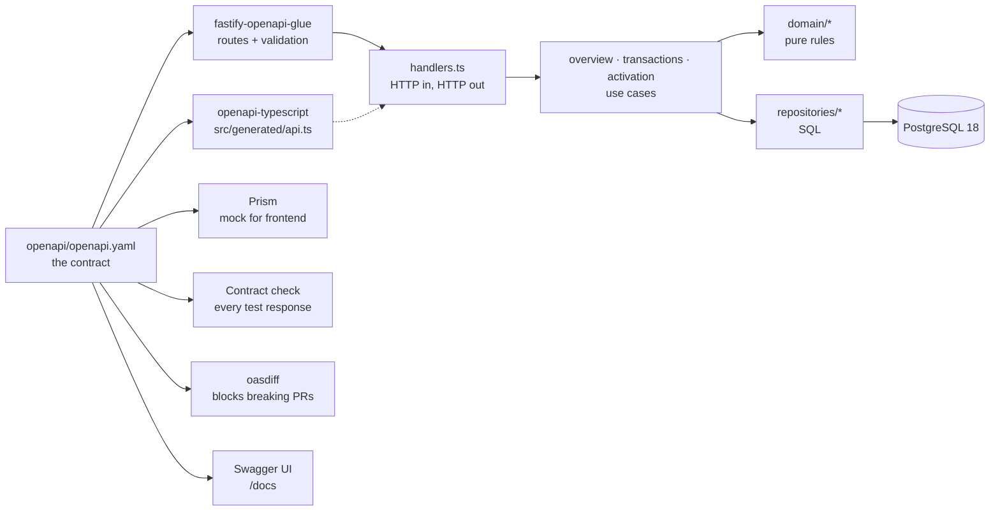
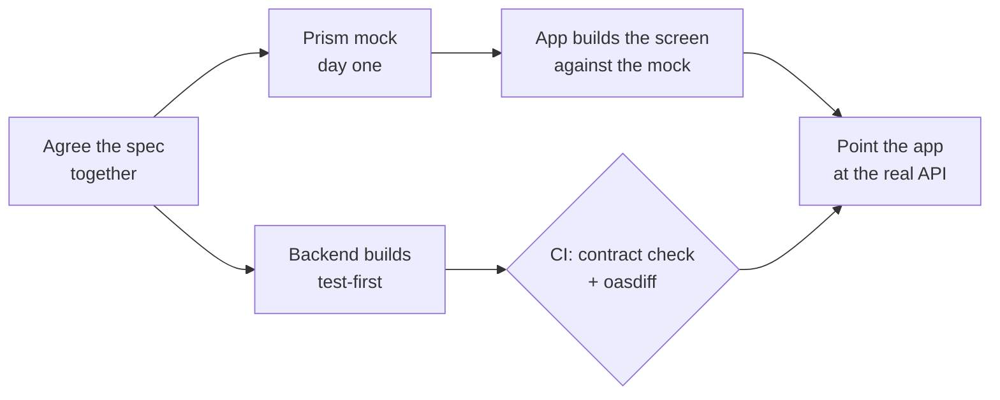
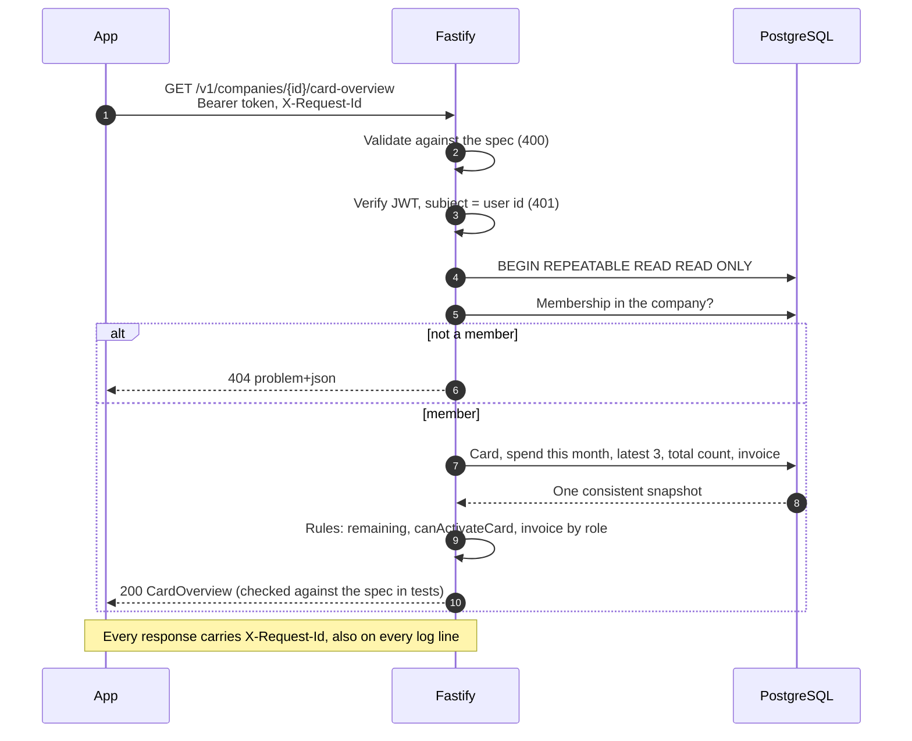
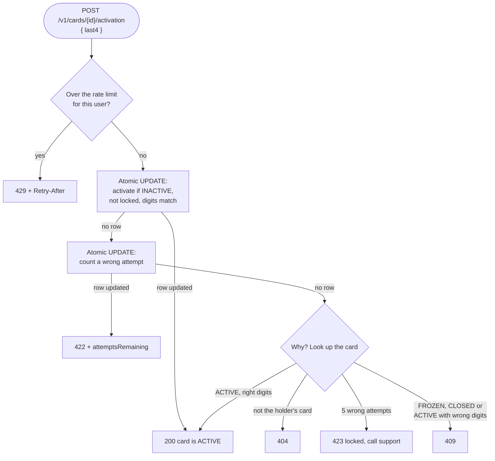

# Card Overview API

Backend for the card overview screen in the mobile app: the company switcher, the card, "Invoice due", remaining spend against the user's own limit, the latest transactions and the "Activate card" button.

Built **contract-first**: the OpenAPI spec was written and mocked before any backend code, so frontend can build in parallel from day one. The spec then drives the code, so the two cannot drift.

- **Contract:** [`openapi/openapi.yaml`](openapi/openapi.yaml)
- **Domain language:** [`CONTEXT.md`](CONTEXT.md)
- **Decisions:** [`docs/adr/`](docs/adr)

## Quick start

Requires Node 26 and Docker.

```bash
npm ci
npm run setup    # .env, Postgres in Docker, migrations, demo data
npm start        # http://localhost:3000
```

Try it with the demo users:

```bash
ANNA=$(npm run -s token -- anna)   # owner of Company AB, active card
ERIK=$(npm run -s token -- erik)   # employee, inactive card (last4 7310)

curl -H "Authorization: Bearer $ANNA" localhost:3000/v1/me/companies
curl -H "Authorization: Bearer $ANNA" localhost:3000/v1/companies/01900000-0000-7000-8000-0000000000c1/card-overview
curl -H "Authorization: Bearer $ANNA" "localhost:3000/v1/cards/01900000-0000-7000-8000-0000000000a1/transactions?limit=5"
curl -X POST -H "Authorization: Bearer $ERIK" -H 'content-type: application/json' \
     -d '{"last4":"7310"}' localhost:3000/v1/cards/01900000-0000-7000-8000-0000000000a2/activation
```

`npm run db:seed` resets the demo data at any time.

**Production build:** `npm run build` compiles to `dist/` and copies the spec and migrations next to it; run with `npm run db:migrate:prod` and `npm run start:prod`. Two instances migrating at once are safe: they take turns on a database lock.

**API docs:** http://localhost:3000/docs (Swagger UI). Click **Authorize**, paste a token from `npm run token -- anna` (or `erik` for activation), and try the calls in the browser; the server menu also switches to the Prism mock. The page shows `openapi.yaml` as written (static mode), so the docs cannot drift from the contract.

**Logs:** `npm run dev` prints readable, coloured logs; `npm start` prints one JSON object per line, as in production. Set the level with `LOG_LEVEL` (`debug`, `info`, `warn`, `error`; default `info`).

**Frontend without the backend:** `npm run mock` serves the contract with Prism on `http://localhost:4010`.

## From the screen to the API

| On screen | Field in `GET /v1/companies/{companyId}/card-overview` |
|---|---|
| Company AB ⌄ | `company`, and the list from `GET /v1/me/companies` |
| Invoice due › | `invoiceDue` (owners and admins only, `null` when nothing is due) |
| Card image › | `card.imageUrl`, `card.status`, `card.last4` |
| 5 400 / 10 000 kr, based on your set limit | `spend.spent`, `spend.limit`, `spend.remaining` |
| Latest transactions | `latestTransactions.items` (3 newest) |
| 54 more items in transaction view › | `latestTransactions.totalCount − items.length`, then `GET /v1/cards/{cardId}/transactions` |
| Activate card | `actions.canActivateCard`, `actions.activationBlockedReason`, then `POST /v1/cards/{cardId}/activation` |
| Contact Qred's support | `support` |

### Payload design

- **One call per screen.** Mobile pays for every round trip, so the screen gets everything at once ([ADR 0002](docs/adr/0002-one-screen-shaped-endpoint.md)).
- **The backend decides.** `remaining`, `canActivateCard` and `activationBlockedReason` are computed on the server, so business rules live in one place and the app has none of its own.
- **Money is `{ minor, currency }`.** Integer öre, never floats; formatting is left to the client's locale ([ADR 0004](docs/adr/0004-money-in-minor-units.md)).
- **`null` means "nothing to show".** A member without a card gets `card: null` and an empty state, not an error.
- **Consistent numbers.** Spend, latest transactions and the total count come from one database snapshot ([ADR 0007](docs/adr/0007-spend-is-computed-on-read.md)).
- **Errors are RFC 9457 `problem+json`**, with extra fields where the app needs them (`attemptsRemaining`).

### Database design

See [`db/migrations/001_init.sql`](db/migrations/001_init.sql).

- **Membership is the access boundary.** `company_members` decides what a user can see; the token only says who they are ([ADR 0006](docs/adr/0006-identity-in-token-access-in-database.md)).
- **The database refuses invalid states**: spend limit above credit limit, an inactive card with an activation date, a zero-amount transaction, a transaction in another currency than its card (composite foreign key, migration 002).
- **Indexes match the queries**: `(card_id, occurred_at DESC, id DESC)` serves both "latest 3" and pagination; a partial index covers only unpaid invoices.
- **PostgreSQL 18** with time-ordered `uuidv7()` ids ([ADR 0003](docs/adr/0003-postgres.md)).

## Architecture

### One spec feeds everything



### Frontend and backend in parallel



### One request: the card overview



### Activating a card



Each step is one SQL statement, so twelve parallel guesses still get exactly five tries.

### Files

```
src/
  app.ts             builds the Fastify app from the spec (used by server and tests)
  server.ts          process entry: config, logging, graceful shutdown
  config.ts          typed, validated config; refuses to start if anything is missing
  auth.ts            JWT verification (HS256, subject = user id)
  problem.ts         problem+json errors
  db.ts              snapshot transactions, safe integer parsing
scripts/             migrate, seed, token
test/                HTTP tests against real Postgres, plus the contract checker
```

## Edge cases handled

- No access to a company or card → **404**, same as "does not exist", so ids of other customers are not confirmed ([ADR 0005](docs/adr/0005-404-when-the-user-has-no-access.md)).
- Member without a card → empty state. Several cards → the newest one that is not closed. Frozen cards are shown.
- Spend uses the **calendar month in Swedish time**: a purchase at 00:30 on the 1st belongs to the new month, across summer/winter time.
- Pending and settled purchases count, refunds reduce spend, declined ones are ignored. Spent never goes below zero and remaining never goes below zero.
- Invoices are visible to owners and admins only. Overdue the day after the due date, in Swedish time.
- Pagination never repeats or skips rows when new transactions arrive; ties on the same timestamp are ordered by id; cursors from another card are rejected.
- Activation requires the last 4 digits, hidden while the card is inactive. Wrong digits → **422** with attempts left; after 5 → **423** until support unlocks. Already active with the right digits → **200** (safe to retry); wrong digits on an active card, or a frozen or closed card → **409** ([ADR 0008](docs/adr/0008-activation-proof-and-lockout.md)).
- Concurrent activation attempts cannot get extra guesses: the counter is one atomic `UPDATE`.
- Activation is also **rate limited per user** across all their cards (10 per 15 minutes by default) → **429** with `Retry-After`. It counts after the token check, so nobody can use up another user's attempts. The lockout protects one card; the rate limit protects the service.
- Unknown request fields are rejected, not silently dropped. Non-JSON bodies get **415** instead of skipping validation. Tokens without an expiry or with a non-uuid subject are rejected.
- Database down → `/health` returns **503**. A dropped idle connection is logged, not a crash; a failed transaction keeps its original error and the broken connection is discarded. Unexpected errors return a generic 500 and are logged, never leaked.

## Logging and tracing a request

- **Every response has an `X-Request-Id`.** The app can send its own; otherwise the backend creates a uuid. The same id is on every log line for that request (`reqId`), so a user's error can be found in the logs from one value.
- An incoming id is only trusted if it is short and plain (letters, digits, `.`, `_`, `-`, max 128). Anything else, such as a line break that could fake log lines, is replaced.
- **Levels mean something:** `error` is a bug or an outage (unhandled error with stack trace, lost database connection), `warn` is degraded (health check cannot reach the database), `info` is one line in and one line out per request. Expected 4xx answers are not errors, so they do not trigger alerts.
- The `Authorization` header is redacted from the logs. `LOG_LEVEL` is validated at startup like the rest of the config.

## Testing

```bash
npm test         # Testcontainers starts its own Postgres; needs Docker
npm run lint && npm run typecheck && npm run spec:check
```

Tests sit at three agreed seams:

1. **The HTTP API**, via `app.inject()` against a real Postgres. This is what the app uses, so tests survive refactoring. No mocked database.
2. **The spend period**, as a pure function, for time-zone and leap-year cases that are hard to hit over HTTP.
3. **The contract.** Every response in every test is validated against `openapi.yaml`: status, content type and body. This check caught a real bug: OpenAPI 3.0 cannot express a nullable `$ref`, so the spec was moved to 3.1.

The tests were checked by breaking the code on purpose (counting declined transactions, showing `last4` on inactive cards, not clamping spend, including closed cards, a read-then-write attempt counter). Each break made a test fail.

CI runs lint, typecheck, spec validation (including that generated types are up to date) and tests on Node 26, the version in `.nvmrc`. Node 26 becomes LTS at the end of October 2026, so a service shipping now starts on the release with the longest support.

CI also fails on known high-severity vulnerabilities in production dependencies (`npm audit --omit=dev`).

On pull requests, [`oasdiff`](https://github.com/oasdiff/oasdiff) compares the spec with `main` and **fails on breaking changes** (a removed field, a field that became optional, a new required input), because the app already in users' phones would break. Adding fields and endpoints passes. This was verified with a test pull request that made `spend.remaining` optional.

## With more time

**Product**
- Activation code sent with the card, stored hashed, instead of the last 4 digits.
- Let the user choose the spend period (week or month) and edit their spend limit.
- Show the original currency and amount for purchases abroad.
- Let owners and admins see every card in the company and its transactions.
- Automatic unlock of activation after a cool-down, if support load requires it.

**Platform**
- Real identity provider (BankID via an OIDC provider) with short-lived tokens and refresh; asymmetric keys (RS256/ES256) so services can verify without the secret.
- A shared rate-limit store (Redis) once there is more than one instance, and a per-IP limit at the edge (API Gateway or WAF) before requests reach the service.
- Idempotency keys on POSTs for payments-style operations.
- Turn `/docs` off, or put it behind auth, in production if the API is not meant to be public.
- Observability: OpenTelemetry traces (W3C `traceparent` next to `X-Request-Id`), RED metrics per route, alerts on 5xx and latency.
- `ETag` / `Cache-Control` on the overview; push updates (SSE or push notifications) when a transaction arrives.
- Deploy: container on ECS Fargate or Lambda behind API Gateway, RDS PostgreSQL, secrets in Secrets Manager, infrastructure as code (CDK), migrations as a pipeline step.

**Scale**
- A monthly spend counter maintained by the database once summing becomes slow, keeping the `SUM` as a reconciliation check.
- Approximate counts or "50+" for cards with very many transactions.
- Read replica for the overview if read traffic dominates.

**Process**
- Contract tests in the frontend's CI too (e.g. against the Prism mock).
- A versioning policy for when a breaking change is truly needed: a new field next to the old one, deprecation, then removal once old app versions are gone.
- Generate a typed client for the app from the same spec.
- Generic resource endpoints (`/cards/{id}`, `/invoices`) once a second screen needs them.
